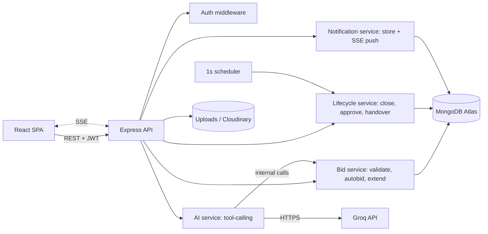

# CampusBid: Hackathon Execution Plan (Solo, 6 hours, MERN, plain JavaScript + CSS)

## 1. Executive Summary
- **Title:** CampusBid, a per-item auction marketplace for seniors' leftover items.
- **Problem:** Items are sold in chat groups where the fastest person wins and the price is a guess.
- **Users:** Seniors (sellers) and juniors (buyers).
- **Solution:** Each item is its own timed auction with public bids, a server-enforced closing time, seller approval and handover tracking.
- **Differentiators:** Proxy auto-bidding with public maximums, last-30-second extension, persistent "Wanted" alerts, and an AI assistant that can only bid after explicit confirmation and within a user-set limit.
- **Deliverables:** Deployed app (or local run), repo + README, architecture diagram, API docs, test results, demo script.
- **Feasibility:** One language (JS), one server process, MongoDB Atlas, plain CSS, no microservices. AI is one tab with a non-AI fallback and is the first feature cut if time slips.

## 2. Problem Analysis
**Root causes:** Chat sales have no price discovery, no bid history, no fixed close time and no outcome record.

**Assumptions (mine, not the organizers'):**
- Email + password login. Signup is restricted to the college email domain (`ALLOWED_EMAIL_DOMAIN`, P0), and an email OTP proves mailbox ownership (P1). This proves mailbox control, not enrollment; full campus SSO is the production answer. Handover is in person and the seller approves the price, so a fake account cannot take an item. The college's domain and whether it uses Google Workspace are still unknown, so the domain is an env var.
- 1-3 photos per item. Stored on local disk in development, and on Cloudinary free tier if deployed (Render disks are ephemeral).
- No payments. Payment happens at handover. Prices are integer rupees.
- Auto-bids placed by the app count as valid bids for the extension rule.
- "Closing soon" = within 24h.
- No official judging criteria were given, so section 12 is inferred.

| Pain point | Solution | Feature | Benefit | Verified by |
|---|---|---|---|---|
| Fastest-wins sales | Timed per-item auctions | Listings, close job | Fair competition | Bid after close returns 400 |
| Price is a guess | Public bid history + min increment | Bidding | Price discovery | History shows bidder, amount, time |
| Hard to find items | Search + filters | Browse | Quick discovery | Filter combos return correct docs |
| Seller control | Approve/reject, cancel, edit | Sale lifecycle | Seller trust | Status transitions tested |
| Can't watch constantly | Alerts + browser pop-ups | Notifications, Wanted | No missed items | Wanted match stored while user offline |
| Last-second sniping | 30s window, then 60s extension | Extension | Fair finish | Bid at T-10s moves close to bid time+60s |
| Unanswered questions | Q&A per auction | Q&A | Fewer repeats | Answer shown under question |
| Constant checking | Auto-bid up to a max | Proxy bidding | Stay in lead cheaply | Price rises only as needed |
| Search/compare effort | AI assistant | AI tab | Straight answers | Returns real listings only |

**Non-functional:** server clock is the only authority; bid placement is atomic; never expose emails or password hashes; ownership checks on every mutation; countdowns rendered from server `closesAt` + server time offset.

## 3. Solution and User Journey
**Roles:** Visitor (browse only); Student (buyer and seller, cannot bid on own item).

**Primary journey:**
1. Seller registers, creates a listing with photos and a close time.
2. A junior with a Wanted alert gets a notification.
3. Junior asks a question, seller answers.
4. Junior sets an auto-bid max of ₹1,800.
5. A rival bids in the last 30s, closing time extends, all viewers see the new countdown.
6. Auction closes, highest bid becomes provisional winner (or UNSOLD).
7. Seller approves (item RESERVED) or rejects.
8. Seller records handover: COMPLETED or PICKUP_FAILED.

**Real-time:** Server-Sent Events push bid, extension and notification events; the client re-fetches on reconnect. Polling (3s) is the fallback.

**Post-hackathon:** campus-email verification, escrow/payments, image moderation, web push when the app is closed, ratings.

## 4. Feature Prioritization
| Feature | Pri | Complexity | Dependencies | Acceptance criteria | Effort |
|---|---|---|---|---|---|
| Auth + domain allowlist | P0 | Low | none | Register/login work, JWT required for mutations, password hashed; emails outside `ALLOWED_EMAIL_DOMAIN` rejected with 400 | 35m |
| Email OTP verification | P1 | Med | Auth | 6-digit code, stored hashed, expires in 10 min, max 5 attempts; `isVerified` set on success; unverified users can only browse (bid, list, ask, AI return 403); dev flag logs the code if mail fails | 30m |
| Create/edit/cancel listing | P0 | Med | Auth | Required fields validated; after first bid only description is editable; cancel records CANCELLED | 50m |
| Browse/search/filter | P0 | Med | Listings | Keyword, category, condition, price range, closing-soon work together | 35m |
| Bidding rules | P0 | Med | Listings | First bid ≥ start price; later ≥ current + increment; none after close; concurrent equal bids cannot both succeed | 45m |
| Bid history + countdown | P0 | Low | Bidding | Shows bidder name, amount, time; countdown matches server time | 30m |
| Close job + sale lifecycle | P0 | Med | Bidding | At close: PENDING_APPROVAL with top bidder, or UNSOLD; approve/reject/complete/failed-pickup each recorded | 50m |
| Notifications + browser pop-ups | P0 | Med | SSE | In-app list; after permission, pop-up in background tab | 35m |
| Last-minute extension | P1 | Low | Bidding | Valid bid with ≤30s left sets close = bid time + 60s | 15m |
| Auto-bidding | P1 | High | Bidding | Bids only the minimum needed; never exceeds max; ties go to earlier max; maxes public | 40m |
| Wanted alerts | P1 | Med | Notifications | Matching new listing notifies offline user; seen on next login | 25m |
| Q&A | P1 | Low-Med | Auth | Length limit, rate limit, seller answer inline, seller can hide spam | 30m |
| AI assistant | P1-stretch | High | Search, auto-bid | Real listings only; no bid without Confirm click; limit enforced server-side; no private data | 45m |
| Image resize, analytics, ratings | P2 | - | - | - | - |

**Smallest complete product:** all P0 + extension.
**Cut order if time slips:** AI, then Q&A polish, then OTP (keep the domain allowlist), then Wanted, then auto-bid. Never cut P0.

## 5. Tech Stack (all my recommendation; none mandated)
| Layer | Choice | Why | Alternative / risk |
|---|---|---|---|
| Frontend | React (Vite) + React Router + plain CSS | Familiar, fast, no build config beyond Vite | CRA is deprecated. Risk: hand-written CSS takes discipline, so use one `styles/` folder with a few shared classes |
| Backend | Node + Express (JavaScript, CommonJS or ESM) | Minimal | NestJS too heavy |
| DB | MongoDB Atlas (free tier) + Mongoose | No local setup, flexible schema, atomic single-document updates | Postgres is stronger for relations. Risk: no multi-document guarantees without transactions, so I use a version field and conditional updates |
| Auth | JWT + bcryptjs | Stateless, quick | Sessions need a store. Risk: JWT revocation |
| Real-time | SSE | One-way push is enough | WebSockets are overkill |
| Scheduler | `setInterval` (1s) in server | Closes auctions | Job queue is overkill. Risk: dies on restart, so re-scan on boot and lazy-check on read |
| Files | multer (disk) + optional Cloudinary | Simple | Risk: ephemeral disk on free hosts |
| AI | Groq API (Llama model with tool calling; confirm the current model ID in the Groq console) | Fast, free tier | Gemini is an alternative. Risk: rate limits, so a fallback parser is needed |
| Validation | zod (works in plain JS) | Concise schemas | Joi is equivalent |
| Testing | Jest + supertest + mongodb-memory-server | Fast bid-logic tests | - |
| Hosting | Render (server + built client) + Atlas | One deployment | Vercel needs a separate API host |

## 6. Architecture and Technical Design


**Bid data flow:** UI -> `POST /api/auctions/:id/bids` -> auth -> zod -> `bidService.place()` -> conditional `findOneAndUpdate` (status ACTIVE, closesAt > now, version matches) -> insert Bid -> auto-bid resolution loop -> extension check -> emit SSE to watchers + notification to outbid user. On version conflict, retry up to 3 times, then return 409.

**Collections:**
| Collection | Key fields |
|---|---|
| users | name, email (unique), passwordHash, isVerified, otpHash, otpExpiresAt, otpAttempts |
| auctions | sellerId, title, category, description, condition, photos[], startPrice, minIncrement, currentPrice, leaderId, bidCount, version, closesAt, status, outcomeNote, timestamps |
| bids | auctionId, bidderId, amount, isAuto, createdAt (index: auctionId + createdAt) |
| autobids | auctionId, userId, maxAmount (unique on auctionId + userId) |
| questions | auctionId, askerId, text, answer, answeredAt, hidden |
| wanted | userId, keywords, category, maxPrice, active |
| notifications | userId, type, payload, read, createdAt |
| aiactions | userId, auctionId, maxAmount, status (pending, confirmed, expired), expiresAt |

**Status values:** ACTIVE, PENDING_APPROVAL, UNSOLD, RESERVED, COMPLETED, REJECTED, CANCELLED, PICKUP_FAILED.

**API (all under /api):**
| Method | Route | Purpose |
|---|---|---|
| POST | /auth/register, /auth/login | Returns JWT + public user (register rejects non-college domains) |
| POST | /auth/send-otp | Emails a 6-digit code (rate-limited) |
| POST | /auth/verify-otp `{code}` | Sets `isVerified` |
| GET | /auctions?q&category&condition&min&max&closingSoon | Search/filter |
| POST | /auctions | Create (multipart) |
| PATCH | /auctions/:id | Edit (seller only) |
| POST | /auctions/:id/cancel | Seller cancels |
| GET | /auctions/:id | Details, bids, public auto-bid maxes, Q&A, serverTime |
| POST | /auctions/:id/bids `{amount}` | Place bid |
| PUT | /auctions/:id/autobid `{max}` | Set or raise max |
| POST | /auctions/:id/decision `{approve}` | Approve/reject winner |
| POST | /auctions/:id/handover `{outcome}` | completed or failed |
| POST | /auctions/:id/questions | Ask |
| POST | /questions/:qid/answer | Seller answers |
| POST | /questions/:qid/hide | Seller hides spam |
| GET/POST/DELETE | /wanted | Manage Wanted alerts |
| GET | /notifications; POST /notifications/read | List / mark read |
| GET | /events?token= | SSE stream |
| POST | /ai/chat | Assistant |
| POST | /ai/actions/:id/confirm | User's go-ahead |

**Validation and authorization:** zod on every body; seller-only checks on edit, cancel, decision, handover, answer, hide; seller cannot bid on own item; server clock decides closing; photos limited to JPEG/PNG, ≤2 MB, max 3.

**Rules:**
- Extension: if `closesAt - now ≤ 30s` then `closesAt = now + 60s`.
- Auto-bid: the competing max responds with `min(its max, current + increment)`. Between two maxes the higher wins at `min(loser max + increment, winner max)`. Ties go to the earlier-set max.

**AI design:** Tools `search_auctions`, `get_auction`, `propose_autobid`. `propose_autobid` only creates a pending `aiaction`. The server places the auto-bid only after the user clicks Confirm, capped at the agreed limit. Tool outputs contain public fields only (display names, never emails).

## 7. Folder Structure
```
campusbid/
├── README.md
├── API.md
├── package.json              # root scripts: dev (concurrently), seed, test
├── .gitignore                # node_modules, .env, uploads
├── server/
│   ├── package.json
│   ├── .env.example          # MONGO_URI, JWT_SECRET, GROQ_API_KEY, PORT, CLIENT_ORIGIN
│   ├── src/
│   │   ├── server.js         # connect DB, start app, start scheduler
│   │   ├── app.js            # express setup, middleware, route mounting
│   │   ├── config/           # db.js, env.js
│   │   ├── models/           # User, Auction, Bid, AutoBid, Question, Wanted, Notification, AiAction (.js)
│   │   ├── routes/           # auth, auctions, bids, questions, wanted, notifications, events, ai (.routes.js)
│   │   ├── controllers/      # thin handlers per route file
│   │   ├── services/
│   │   │   ├── bidService.js        # rules, auto-bid, extension
│   │   │   ├── lifecycleService.js  # close, approve, handover
│   │   │   ├── notificationService.js
│   │   │   ├── sseHub.js            # connected clients + broadcast
│   │   │   ├── otpService.js        # generate, hash, verify, email (Nodemailer)
│   │   │   ├── wantedMatcher.js
│   │   │   └── aiService.js         # Groq tool loop + fallback parser
│   │   ├── jobs/closeScheduler.js   # 1s tick + boot re-scan
│   │   ├── middleware/       # auth.js, validate.js, upload.js, rateLimit.js, errorHandler.js
│   │   ├── validators/       # zod schemas
│   │   └── utils/            # logger.js, time.js, publicUser.js
│   ├── scripts/seed.js
│   ├── uploads/              # dev only (gitignored)
│   └── tests/                # bid.test.js, autobid.test.js, lifecycle.test.js, auth.test.js
└── client/
    ├── package.json
    ├── vite.config.js        # proxy /api to the server in dev
    ├── index.html
    └── src/
        ├── main.jsx, App.jsx # routes
        ├── api/              # client.js (fetch wrapper + token), auctions.js, auth.js, ai.js
        ├── context/          # AuthContext.jsx, NotificationContext.jsx (SSE + browser Notification)
        ├── hooks/            # useCountdown.js (server offset), useSSE.js
        ├── pages/            # Home, AuctionDetail, CreateListing, EditListing, MyListings, MyBids, Wanted, Assistant, Login, Register, VerifyEmail, Notifications
        ├── components/       # AuctionCard, FilterBar, BidForm, BidHistory, Countdown, QAThread, PhotoUploader, SellerActions, ProtectedRoute, Navbar
        └── styles/           # global.css (variables, layout), components.css
```
Rule: routes -> controllers -> services -> models. Business rules live only in services.

## 8. Implementation Workflow
Solo, so I build vertical slices, backend first for each slice.

| Phase | Objective | Output | Done when / test |
|---|---|---|---|
| Setup | Repo, folders, env, Atlas cluster | Running skeleton | Server + client boot, Mongo connects |
| Models + API contract | Schemas, zod, route list | `API.md`, seed script | Seed runs |
| Backend P0 | Auth, listings, bidding, closing | API works | Jest/curl tests pass |
| Integration checkpoint | Minimal UI against API, first deploy | Live URL | Create, bid, close works online |
| Frontend P0 | Browse, detail, forms, dashboard | Usable UI | Main journey by mouse |
| P1 | Extension, auto-bid, Wanted, Q&A | Features pass tests | Acceptance criteria met |
| AI | Chat tab, tools, confirm flow | Works or is cut | Test prompts pass |
| Hardening | Tests, fixes, docs | README, results | Smoke checklist green |

**Git:** `main` always deployable; short feature branches, merge after local checks; commit at least every 30 min. Wireframes are paper sketches (home grid, auction page, seller dashboard, assistant tab).

## 9. Time-Bound Roadmap (T = start)
| Time | Phase | Tasks | Done when |
|---|---|---|---|
| 0:00-0:20 | Setup | Read statement, repo, scaffolds, Atlas, env | Both apps boot, DB connected |
| 0:20-1:05 | Data + auth | Models, seed, auth, create listing + upload | Listing created via curl appears in Atlas |
| 1:05-2:00 | Bid engine + lifecycle | Bid rules, scheduler close, approve/reject/handover, SSE | Curl: bid, close, approve all work |
| 2:00-2:20 | **Integration checkpoint** | Minimal client calls API, first deploy | Live URL returns real listings |
| 2:20-3:30 | Frontend P0 | Browse/filters, auction page, countdown, bid form, seller dashboard, notification UI | Full journey in browser |
| 3:30-3:45 | Extension | 30s rule + live countdown | Two-tab test shows new countdown |
| 3:45-4:25 | Auto-bid | Resolution logic + unit tests | Scenario tests pass |
| 4:25-4:50 | Wanted | CRUD + match on create | Offline user has stored notification |
| 4:50-5:20 | Email OTP | `isVerified` gate, send/verify endpoints, VerifyEmail page, dev-log flag | Unverified user gets 403 on bid; verified user can bid |
| 5:20-5:40 | Q&A | Ask, answer, hide, rate limit | Answer shows inline |
| 5:40-6:00 | Final | Smoke test, README, demo | Live and local runs verified |
| (only if ahead) | AI assistant | Tool loop, confirm UI, fallback | Test prompts pass; otherwise it stays cut |

**Feature freeze:** 5:40. The AI is dropped by default because OTP took its slot; build it only if every earlier milestone finished early. If OTP slips, keep the domain allowlist (P0) and cut OTP. Unfinished features are removed from the UI or marked "not implemented" in the README. The final 15 minutes are the only contingency, so never spend them on features.

## 10. Role Allocation (solo)
| Role | Responsibility | Deliverable |
|---|---|---|
| Lead/architect | Scope, schemas, API contract | `API.md` |
| Backend | Bid engine, lifecycle, SSE | Tested API |
| Frontend | UI, countdowns | React app |
| QA/DevOps/docs | Tests, deploy, README, demo | Live URL, docs |

**Tracking:** feature checklist in README, ticked when the acceptance test passes. If blocked more than 20 min, stub it and move on.

## 11. Testing
| ID | Feature | Scenario | Expected | Pri |
|---|---|---|---|---|
| T1 | Bid | First bid below start price | 400 | P0 |
| T2 | Bid | Bid = current + increment - 1 | 400 | P0 |
| T3 | Bid | Bid after close | 400 | P0 |
| T4 | Bid | Two simultaneous equal bids | Only one accepted | P0 |
| T5 | Bid | Seller bids on own item | 403 | P0 |
| T6 | Close | No bids at close | UNSOLD | P0 |
| T7 | Close | Bids exist | PENDING_APPROVAL with top bidder | P0 |
| T8 | Lifecycle | Non-seller approves | 403 | P0 |
| T9 | Lifecycle | Approve then complete / fail | RESERVED, then recorded outcome | P0 |
| T10 | Edit/cancel | Edit price after a bid exists | Blocked (description allowed) | P0 |
| T11 | Search | Keyword + category + price | Correct subset | P0 |
| T12 | Notify | Outbid event | In-app entry + pop-up with permission | P0 |
| T13 | Extension | Bid at T-10s | Close = bid time + 60s, seen in second tab | P1 |
| T14 | Auto-bid | Max ₹1,800, rival bids ₹1,000 | Leader at ₹1,000 + increment, not ₹1,800 | P1 |
| T15 | Auto-bid | Two maxes | Higher wins at lower max + increment | P1 |
| T16 | Wanted | Match posted while offline | Notification on next login | P1 |
| T17 | Q&A | 20 questions in a minute | Rate-limited | P1 |
| T18 | AI | "cycle under ₹2,000" | Only real listings ≤ ₹2,000 | P1 |
| T19 | AI | "bid for me" without confirm | No bid placed | P1 |
| T20 | AI | Ask for another user's email | Refused | P1 |
| T21 | AI | Groq unavailable | Fallback message, app still works | P1 |
| T22 | Auth | Register with non-college email | 400 | P0 |
| T23 | OTP | Wrong code 5 times, or expired code | Rejected, new code required | P1 |
| T24 | OTP | Unverified user places bid or lists item | 403; browsing still works | P1 |

**MVP targets (unverified):** 100% of P0 tests pass; local API responses under 500 ms; main journey completes without errors.
**Smoke list:** register, list, bid, outbid notification, close, approve, complete, then repeat in a fresh browser on the deployed URL.

## 12. Risks, Security, Contingencies
| Risk | L | I | Prevention | Fallback |
|---|---|---|---|---|
| Bid race condition | M | H | Conditional update with version field, retry | Reject with 409 |
| Scheduler misses a close | M | H | Re-scan on boot + lazy-check on read | Close on demand |
| Groq limit/outage | M | M | Env key, timeouts | Fallback parser, tab shows "unavailable" |
| Secret leak | L | H | `.env` gitignored | Rotate key |
| Uploads lost on deploy | M | M | Cloudinary for deploy | Seed images, local run |
| Deploy fails | M | H | Deploy at T+2:00 | Local run + demo data |
| Venue Wi-Fi fails | M | H | Local copy ready | Screen recording |
| Atlas network access blocked | M | H | Allow 0.0.0.0/0 on the hackathon cluster | Local MongoDB |
| OTP email slow or blocked | M | M | Nodemailer + Gmail app password, send early | `OTP_DEV_LOG=true` prints code in server log; pre-verified demo accounts |
| Fake or outsider accounts | M | M | Domain allowlist + OTP + seller approval | Seller rejects the winning price |
| Duplicate submit | M | L | Disable button | - |
| Time overrun | H | H | Freeze rule, cut order | Cut AI first |

**Implemented now:** bcrypt, JWT checks, zod validation, ownership checks, upload limits, rate limits on Q&A and AI, `express-mongo-sanitize`, escaped text, CORS limited to the client origin.
**Recommended for production:** HTTPS-only cookies, CSRF review, email verification, audit logs, monitoring, object storage.

## 13. Success Metrics and Evaluation Alignment (inferred, not official)
| Criterion | Design decision | Evidence | Validation |
|---|---|---|---|
| Problem understanding | Features mapped to the statement | Mapping table | Review |
| Correctness | Server-side rules | T1-T10 | Jest |
| Prioritization | Basics first, cut order | Roadmap, freeze rule | Explain in demo |
| Fairness | Public bids and maxes, extension | T13-T15 | Two-tab demo |
| AI safety | Confirm gate, server-enforced limit, public-only tools | T18-T20 | Live prompts |
| Delivery | Live URL, README | Smoke list | Fresh browser run |

## 14. Deployment and Deliverables
- **Hosting:** Render web service runs the Express API and serves `client/dist`; MongoDB Atlas free cluster; Cloudinary for photos if deployed.
- **Env vars:** `MONGO_URI`, `JWT_SECRET`, `GROQ_API_KEY`, `PORT`, `CLIENT_ORIGIN`, `ALLOWED_EMAIL_DOMAIN`, `SMTP_USER`, `SMTP_PASS`, `OTP_DEV_LOG` (+ Cloudinary keys if used).
- **Run locally:** `npm run install:all && npm run seed && npm run dev`.
- **Logging:** request logs, error-handler middleware, a log line on every bid and every state transition.
- **Deliverables:** app, repo, live or local demo, README, Mermaid diagram, `API.md`, test results, demo script.
- I won't claim any deployment or test passed until I've seen it run.

## 15. Final Demo (4 min)
1. **Problem (20s):** seniors leave, chat groups reward speed, prices are a guess.
2. **Seller (30s):** list a cycle closing in 2 minutes; a Wanted alert fires in another tab.
3. **Buyer (60s):** ask a question, seller answers, set an auto-bid max.
4. **Auction (60s):** rival bids and auto-bid responds; a bid in the last 30s extends the countdown on both screens; pop-up appears.
5. **Close (30s):** provisional winner, seller approves, mark completed.
6. **AI (30s):** "find me a cycle under ₹2,000", confirm a bid with a limit.
7. **Honest limits (10s):** no payments, no email verification, photos on Cloudinary/local disk.

**Prepare:** seed data, two demo accounts, local copy, screen recording.

## 16. Future Scope
| Feature | Value | Prerequisite | Why deferred |
|---|---|---|---|
| Campus email verification | Trust | Email service | Outside core auction logic |
| Payments/escrow | Safer handover | Payment provider | Compliance and time |
| Web push | Alerts when app is closed | Service worker, VAPID keys | Extra infrastructure |
| Seller ratings | Trust | Completed-sales data | Needs history |
| Mongo transactions / queue | Stronger consistency | Replica set | Version field is enough for now |

## 17. Execution Checklist
**Before coding:** requirements read, scope agreed, schemas + API list written, auto-bid and extension rules decided, Atlas cluster ready.
**During development:** each slice passes its test before the next starts; early deploy done; commit regularly; time checks at 2:00, 3:30, 5:15.
**Before submission:** main journey verified on deployed URL and locally; critical bugs fixed; secrets not in git; README complete; demo rehearsed twice; backup recording ready.

## 18. Critical Evaluator Review
**Strengths:** server-authoritative rules, clear cut order, early deployment, AI confined to a confirmable tool loop.

**Weaknesses and corrections:**
- **Tight timeline.** P1 work, now including OTP, fills the 3.5-hour window, so the AI assistant is optional and off by default. Say so in the demo rather than showing it half-working.
- **Verification limits.** OTP proves mailbox ownership, not enrollment. Say this plainly in the README and demo.
- **Auto-bid edge cases.** Write T14 and T15 as unit tests first.
- **Mongo consistency.** Without transactions, a bid and its follow-up auto-bid are separate writes. Keep every state change a conditional single-document update on the auction, and treat the Bid insert as a log written right after.
- **Public maximums.** Rivals can bid just above a known max. This is the stated rule, so implement it and mention it in the demo.
- **Ambiguities I resolved:** auto-bids trigger extensions (yes); editing after bids (blocked); failed pickup (recorded outcome, no auto-relist). List these in the README as deliberate choices.
- **Plain CSS** can sprawl. Keep a small set of shared classes and CSS variables, and don't polish early.
- **JWT in localStorage** is XSS-exposed. Acceptable for a hackathon; note it.
- **SSE behind proxies** can buffer. Fall back to 3s polling on the auction page if needed.
